# 랜드마크 (landmark)

<p align="center">
  <picture>
    <source media="(prefers-color-scheme: dark)" srcset="docs/readme/hero-dark.svg">
    
  </picture>
</p>

> 2026-10-11 저장소를 `sch0718/trip-map`에서 `sch0718/landmark`로 옮기며 이름을 바꿨습니다(옛 이름 trip-map). 기존 데이터와 이미 보낸 공유 파일이 계속 동작하도록 저장 키(`tripmap:*`)와 공유 파일 형식(`tripmap-share`)은 그대로 둡니다. 예전 landmark 저장소의 내용은 `archive/java-gradle-2025`(Java 코드), `archive/map-pages-2026-10`(이전 직전의 지도 페이지) 브랜치에 있습니다.

평소에 모아 두고(보관함), 여행 때 꺼내 쓰는(계획) 장소 보관함 웹앱입니다. 운영 주소는 **https://landmark.sch0718.dev** 이고, 휴대폰 홈 화면에 앱처럼 추가할 수 있습니다.

## 기능

- **보관함**: 맛집·가 보고 싶은 곳을 **라벨**(한 장소에 여러 개, 색·이모지)로 모으고 메모를 남깁니다. 라벨·지역(시·도 → 시·군)·검색으로 거르고, 카드·타일·목록·벤토로 보며, 지도에서 확인합니다. `라벨 찾기` 창으로 라벨이 많아도 빨리 고릅니다.
- **장소 추가**: 네이버 지도 링크 붙여넣기, 네이버 공유 폴더 가져오기(폴더 연결 뒤 새로 저장한 곳만 다시 가져오기), 지도에 핀 찍기.
- **다녀온 곳·한 줄 평**, **내 근처 저장 장소**(가까운 순·반경), **영업시간·휴무 경고**.
- **여행 계획**: 후보 → Day 배치, 자동차·도보 경로와 이동 시간, 도착 시각, 네이버 지도 길찾기. 여행 당일에는 **당일 모드**(오늘 일정·다음 장소 길찾기·다녀옴 체크).
- **약속장소 정하기**: 여러 사람의 출발지에서 대중교통·자동차·직선거리로 공평한 번화가 역을 찾고, 역 근처 보관함 장소를 후보로 담아 **링크로 함께 고른 뒤 확정**합니다.
- **공유**: 고른 장소나 여행 일정을 **링크**(`/view#d=…`) 또는 **HTML 파일 하나**로 보내고, 받은 사람은 설치·로그인 없이 보고 `Landmark에 담기`로 자기 보관함에 가져옵니다.
- **전체 백업·복원**: 설정 › 백업에서 보관함 전체를 파일로 받고 되살립니다.

변경 내역은 [GitHub Releases](https://github.com/sch0718/landmark/releases)에, 버전별 되돌리기와 데이터 호환은 [롤백](docs/rollback.md)에 있습니다.

## 개요

- 서버 DB와 로그인이 없습니다. 보관함은 **각 기기 브라우저의 localStorage**(`tripmap:library:v2`)에 저장되고, 화면 설정은 `tripmap:prefs`에 저장됩니다. 저장소를 쓸 수 없는 환경(예: 일부 사생활 보호 모드)에서는 메모리 모드로 동작하며 배너로 알립니다.
- 옛 버전(정적 여행 뷰어)의 여행은 `/t/<publicId>`에서 **미리보기 → 결정 → 가져오기**로 새 보관함에 옮깁니다. 옛 편집 레이어(`tripmap:edit:<publicId>`)는 읽기만 하고 지우지 않습니다.
- 앱은 Effect 4 기반입니다(`effect`·`@effect/vitest` 4.0.2 고정).
- 설계 문서(`docs/superpowers/specs/`, 계획은 `docs/superpowers/plans/`). 충돌하면 나중 문서가 우선합니다.
  - 기반·보관함 `2026-10-08-place-library-design.md`, 장소 추가 `2026-10-12-place-adding-design.md`, 여행 계획 `2026-10-12-trip-planning-design.md`
  - 공유: HTML 내보내기 `2026-10-11-html-share-export-design.md`, 가져오기 `2026-10-13-share-import-design.md`, 일정 공유 `2026-10-16-trip-share-design.md`, 링크 공유 `2026-10-22-share-link-design.md`
  - 다듬기: 결함·코드 정리 `2026-10-13-polish-cleanup-design.md`, 첫 로딩 `2026-10-13-first-load-design.md`, 디자인 QA `2026-10-14-design-qa-design.md`
  - F 묶음(개요 `2026-10-16-f-series-overview.md`): 백업·복원, 다녀온 곳·한 줄 평, 폴더 다시 가져오기, 내 근처, 당일 모드, 영업시간(`2026-10-16-*-design.md`)
  - 사용성 개선: 선택·거르기·툴팁 `2026-10-18-selection-filter-tooltip-design.md`, 휴대폰 시트·라벨 고르기 `2026-10-18-mobile-sheet-label-picker-design.md`, 많은 장소 `2026-10-22-large-library-design.md`, 라벨 이모지 `2026-10-23-label-emoji-design.md`·`2026-10-23-label-emoji-only-design.md`
  - 약속장소 `2026-10-23-meeting-place-design.md`
  - 옛 설계: `2026-10-03-trip-map-design.md`

## 설치

### Node 요구 사항

- **Node 24** (`.nvmrc` = `24`). `nvm use`로 맞춥니다.
- 패키지 매니저는 Yarn 1(`packageManager: yarn@1.22.22`).
- 일부 개발 의존성의 `engines`가 `package.json`의 `engines.node`(`>=22`)보다 좁습니다.
  - jsdom 30: `^22.22.2 || ^24.15.0 || >=26`, @babel/core 8: `^22.18.0 || >=24.11.0`
  - 그래서 Node 24.1 같은 이른 마이너 버전에서는 `yarn install`이 engines 오류로 멈춥니다(2026-10-04 확인: 24.1.0에서 실패).
  - 그래서 저장소 루트의 `.yarnrc`에 `ignore-engines true`를 두었습니다. 로컬·CI·Cloudflare Pages 모두 플래그 없이 `yarn install`이 됩니다.

```bash
nvm use                         # Node 24
yarn install --frozen-lockfile  # .yarnrc의 ignore-engines가 적용된다
```

### 환경변수

| 이름                       | 용도                                                                          |
| -------------------------- | ----------------------------------------------------------------------------- |
| `VITE_NAVER_MAP_CLIENT_ID` | 네이버 지도 JS API v3(NCP) Client ID. 로컬은 `.env.local`(gitignore)에 둡니다 |
| `VITE_MAP_ADAPTER`         | `fake`면 네이버 SDK 대신 DOM 가짜 지도를 씁니다(E2E·키 없는 개발용)           |

```bash
echo 'VITE_NAVER_MAP_CLIENT_ID=<발급받은 Client ID>' > .env.local
```

**NCP 콘솔 도메인 등록**: Maps 애플리케이션의 Web 서비스 URL에 아래 주소를 등록해야 지도가 뜹니다.

- 운영 도메인 `https://landmark.sch0718.dev`와 Pages 기본 주소 `https://landmark-c5f.pages.dev`
- `http://localhost:5173`(`yarn dev`)
- `http://localhost:8788`(`yarn dev:full`)

**NCP Reverse Geocoding 켜기**: 지도에서 핀으로 장소를 추가할 때 주소를 자동으로 채우려면 같은 Maps 애플리케이션에서 Reverse Geocoding API를 켜야 합니다. 꺼져 있으면 주소 칸이 비어 직접 입력해야 합니다.

NCP Maps 요금·무료 사용량: **확인 필요**(배포 후 확인해 날짜와 함께 여기에 기록).

## 개발

```bash
yarn dev                           # http://localhost:5173 (네이버 지도, .env.local 필요)
VITE_MAP_ADAPTER=fake yarn dev     # 가짜 지도
yarn dev:full                      # http://localhost:8788 (Vite + 서버 함수 /api/*)
```

### 서버 함수 함께 띄우기 (`yarn dev:full`)

링크·폴더로 장소를 추가하는 기능, 여행·약속의 경로 계산, 장소 이름 검색, 영업시간은 Cloudflare Pages Functions(`functions/api/place.ts`, `naver-folder.ts`, `route.ts`, `search.ts`, `hours.ts`)를 부릅니다. `yarn dev`만 띄우면 `/api/*`가 없어 링크 추가가 `인터넷 연결을 확인하고 다시 시도해 주세요`로 끝나고, 여행 구간의 이동 시간은 직선 추정으로 표시됩니다.

`yarn dev:full`은 `wrangler pages dev`가 Vite 개발 서버(5173)를 띄우고 그 앞에서 `http://localhost:8788`로 받습니다. `/api/*`는 함수가, 나머지는 Vite가 응답합니다(HMR 유지). **브라우저는 8788로 엽니다.**

```bash
curl -H 'Origin: http://localhost:8788' 'http://localhost:8788/api/place?url=https%3A%2F%2Fnaver.me%2FFk73Vab5'
```

- 함수는 요청 출처(`Origin`, 없으면 `Referer`)가 배포 주소·미리보기 주소·`http://localhost:5173`·`http://localhost:8788`일 때만 응답합니다(그 밖은 403 `FORBIDDEN_ORIGIN`).
- 함수 코드는 `src/server/*`를 상대 경로로 가져옵니다(wrangler에는 `src/` 별칭이 없음). React·MUI·Effect를 가져오지 않습니다.
- `wrangler pages dev`의 명령 프록시(`-- <명령>`, `--proxy`)는 wrangler 4.142.0에서 "deprecated" 경고를 냅니다. 이 버전에서 Vite 개발 서버와 함수를 함께 띄우는 방법은 이것뿐이라(대안 `wrangler pages dev dist`는 빌드 결과만 서빙해 HMR이 없음) 그대로 씁니다. IPv6·`compatibility_date` 경고도 무시해도 됩니다. 로컬 상태는 `.wrangler/`(gitignore)에 생깁니다.

### 화면 경로

| 경로               | 화면                                                                                             |
| ------------------ | ------------------------------------------------------------------------------------------------ |
| `/`                | 보관함(카드·타일·목록·벤토 보기, 라벨·지역·검색 거르기, 정렬, 내 근처, 선택 일괄 작업)           |
| `/map`             | 보관함 지도(라벨 색 마커·이모지, 보관함과 같은 거르기, 내 위치)                                  |
| `/place/:id`       | 장소 상세(이름·분류 편집, 라벨 바꾸기, 메모 자동 저장, 다녀옴·한 줄 평, 영업시간, 삭제 되돌리기) |
| `/labels`          | 라벨 관리(이름·색·이모지·순서·병합·삭제, 이름으로 이모지 정하기, 네이버 폴더 다시 가져오기)      |
| `/settings`        | 설정(테마·모드, 보관함 보기, 백업·되살리기, 옛 여행 가져오기, 데이터 정보)                       |
| `/trips`           | 여행 목록(카드, 새 여행, 이름 바꾸기·삭제)                                                       |
| `/trips/:id`       | 여행 계획(후보 · 지도 · Day 시간표, 경로·도착 시각, 순서 정리·Day 자동 나누기, 일정 공유)        |
| `/trips/:id/today` | 여행 당일 모드(오늘 일정, 다음 장소 길찾기, 다녀옴 체크, 늦어짐)                                 |
| `/meetings`        | 약속 목록                                                                                        |
| `/meetings/:id`    | 약속 편집(참석자·출발지, 중간 지점 찾기, 후보, 답장 집계, 확정)                                  |
| `/meet`            | 약속 링크(`#d=` 후보 보고 답장, `#r=` 답장 반영, `#f=` 확정 보기)                                |
| `/view`            | 받은 공유 링크 보기(`#d=…`, `Landmark에 담기`)                                                   |
| `/t/:publicId`     | 옛 여행 가져오기                                                                                 |
| `/import`          | 받은 공유 파일 가져오기(`/`로 바뀌고 고르기·미리보기 칸이 열림)                                  |

- 화면 폭에 따라 ≥1280px 3단, 768–1279px 2단 + 상세 오버레이, 768px 미만 하단 탭(보관함·지도·＋·여행·약속·설정)입니다. 휴대폰의 장소 상세는 지도·목록 위 아래쪽 시트로 열립니다.
- **메모 자동 저장**: 입력을 멈춘 뒤 저장하고, 다른 화면으로 이동하거나 탭을 백그라운드로 보낼 때 대기 중인 초안을 먼저 저장합니다. 탭·브라우저를 바로 닫을 때는 저장이 비동기 Web Lock 안에서 실행되므로 **최선 노력(best-effort)** 입니다. 백그라운드 전환과 앱 안 이동에서는 안정적으로 저장됩니다.
- 네이버 지도 길찾기는 여행 구간(`네이버 지도로 길찾기`)·당일 모드의 다음 장소·약속 확정 화면에 있습니다(좁은 화면은 앱 주소 `nmap://`, 그 밖은 웹). 장소 상세에는 길찾기 대신 "네이버 지도에서 열기"가 있습니다.

| 명령                 | 내용                                                                                                                                                              |
| -------------------- | ----------------------------------------------------------------------------------------------------------------------------------------------------------------- |
| `yarn lint`          | ESLint                                                                                                                                                            |
| `yarn fm:check`      | Prettier 포맷 검사                                                                                                                                                |
| `yarn typecheck`     | `tsc -b --noEmit`                                                                                                                                                 |
| `yarn test`          | Vitest 단위·컴포넌트 테스트                                                                                                                                       |
| `yarn test:e2e`      | Playwright E2E(아래)                                                                                                                                              |
| `yarn validate`      | `trips/*.yaml`과 `public/data/*.json` 스키마 검증                                                                                                                 |
| `yarn orphans`       | 앱 진입점에서 닿지 않는 `src/**` 파일(쓰지 않는 옛 코드) 찾기. 정상이면 `orphans: none`                                                                           |
| `yarn effect:source` | `.reference/effect/`에 현재 `effect` 버전의 소스를 받습니다(API 확인용, 커밋 안 함)                                                                               |
| `yarn build:viewer`  | 공유 파일의 보기 화면 틀을 `public/share-viewer.html`로 빌드(gitignore). `dev`·`dev:full`·`build`가 먼저 실행                                                     |
| `yarn build:map`     | 공유 파일 안 iframe이 띄우는 지도 페이지를 `dist-map/`으로 빌드(아래 "공유 파일과 지도 페이지")                                                                   |
| `yarn build:icons`   | `docs/branding/icon-a.svg`(앱 아이콘 원본)에서 `public/favicon.svg`와 홈 화면·manifest용 PNG 아이콘을 다시 만듭니다                                               |
| `yarn build:hero`    | README 맨 위 움직이는 소개 그림(`docs/readme/hero-light.svg`·`hero-dark.svg`)을 `scripts/build-readme-hero.mjs`로 다시 만듭니다. 색은 파스텔 테마 토큰을 읽습니다 |
| `yarn build`         | 보기 화면 틀 + 타입 검사 + Vite 빌드 → `dist`                                                                                                                     |
| `yarn size`          | 첫 화면 JS·전체 JS 크기(원본·gzip)를 재고 `perf-budget.json` 예산을 넘으면 실패(`docs/ui-performance.md`)                                                         |
| `yarn build:ci`      | `validate → typecheck → test → build → size → build:map` (배포 빌드 명령)                                                                                         |

### E2E

```bash
yarn playwright install chromium webkit   # 처음 한 번
yarn test:e2e:ci                          # CI 핵심 사용자 흐름
yarn test:e2e                             # 전체
E2E_PORT=5175 yarn test:e2e               # 5173을 다른 프로젝트가 쓰고 있을 때
```

- `test:e2e`·`test:e2e:ci`는 먼저 `yarn build:map:e2e`(가짜 지도로 지도 페이지 빌드)를 돌립니다.
- 앱 개발 서버 포트는 기본 5173이고 `E2E_PORT`로 바꿉니다. 5173을 남의 서버가 쓰고 있으면 `reuseExistingServer` 때문에 그것을 앱으로 착각하고 시험하므로 그럴 때 `E2E_PORT`를 씁니다. 내보낸 파일 안 지도 페이지(`dist-map/`)는 5180에서 `vite preview`로 띄웁니다(`SHARE_MAP_URL`, `tests/e2e/fixtures.ts`).

- 프로젝트(`playwright.config.ts`): `desktop`(Chromium 1280×800, 3단), `iphone`(WebKit, iPhone 13 390×844), `galaxy`(Chromium 360×780, 터치). 핵심 흐름 테스트 제목에 `@smoke`가 붙어 있고 CI(`test:e2e:ci`)는 그것만 돌립니다.
- spec(`tests/e2e/`)
  - 보관함: `library.spec.ts`(라벨 필터·목록·지도·상세, 메모·새로고침, 두 탭 동시 메모), `mobile-sheet.spec.ts`(휴대폰 상세 시트), `large-library.spec.ts`(라벨 찾기·지역 두 단계), `labels-emoji.spec.ts`(라벨 이모지), `nearby.spec.ts`(내 근처), `visited-review.spec.ts`(다녀옴·한 줄 평), `business-hours.spec.ts`(영업시간·휴무 경고), `first-load.spec.ts`(첫 화면)
  - 장소 추가: `place-adding.spec.ts`(링크·폴더·핀), `folder-resync.spec.ts`(폴더 다시 가져오기), `legacy-import.spec.ts`(`/t/e2etest000001`)
  - 여행·약속: `trip-planning.spec.ts`(만들기·후보·Day 배치·경로), `trip-today.spec.ts`(당일 모드), `meetings.spec.ts`(약속장소·후보·답장·확정 링크)
  - 공유·백업: `share-export.spec.ts`(HTML 파일), `share-link.spec.ts`(링크·`/view`), `share-import.spec.ts`(＋ 시트·`Landmark에 담기`·PC 끌어 놓기), `trip-share.spec.ts`(일정 공유), `backup-restore.spec.ts`(받기 → 되살리기 → 되돌리기, 손상 화면)
  - `themes.spec.ts`(테마 3 × 라이트/다크 스크린샷)
- 보관함 시드는 `tests/fixtures/library/seed.json`(장소 30·라벨 6)을 `page.addInitScript`로 `localStorage['tripmap:library:v2']`에 심습니다. 형식은 `tests/unit/schema/library-seed.test.ts`가 `LibrarySchema`로 검증합니다.
- 스크린샷은 `test-results/screens/`(보관함·상세)와 `test-results/themes/<project>-<theme>-<mode>.png`에 남습니다. 비교 단언 없는 산출물이며, Playwright가 실행할 때마다 `test-results/`를 비우므로 전체 실행(`yarn test:e2e`) 뒤에 확인하세요.
- 실물 iPhone·Android는 이 E2E로 대체되지 않습니다(에뮬레이션). 실물 기기 점검은 다듬기 D4에서 하며 아직 하지 않았습니다.
- global setup이 `tests/fixtures/trips/e2e.json`을 `public/data/e2etest000001.json`으로 복사하고 teardown이 지웁니다. 이 파일은 커밋하지 않습니다(`.gitignore`). 옛 여행 가져오기(`/t/e2etest000001`) 시험에 쓰입니다.
- 지도는 `VITE_MAP_ADAPTER=fake`로 DOM 가짜 지도를 씁니다. 유효 키의 실 SDK 및 실물 기기 테스트와 구분합니다.

### 측정과 구현 호환

제품 `f9f8fc2`의 과거 검증은 CI678·native68 PASS/3 skip·production39 first PASS/FLAKY0입니다. 활성 geometry의 과거 cache 복귀를 막는 수정과 실제 입력 회귀를 포함합니다. 당시 CPU4x p95 60.4/56.0/122.0/49.5/135.5ms와 장소→일정 >100ms 작업3건은 이전 엄격한 예산에서 FAIL이었습니다. 2026-10-05 사용자 결정으로 PoC 목표를 p95≤300ms·30회 중 >100ms 작업 최대5회로 완화해 이 기록을 수용합니다. 최신 성능 재측정 결과는 아닙니다. [성능 기록](docs/ui-performance.md)에 과거 판정과 원자료를 보존합니다.

CI는 PR과 main push에서 핵심 사용자 흐름(`@smoke`)만 실행하고, 전체 E2E는 수동 실행(workflow_dispatch)으로 분리했습니다. (옛 화면 시절의 [검증 범위](docs/ui-validation.md) 문서는 v2에서 대체됐습니다.)

```bash
VITE_MAP_ADAPTER=fake yarn build
node scripts/measure-ui-assets.mjs dist/assets
```

측정 스크립트는 JS/CSS 파일별 원본·gzip 바이트와 전체 합을 JSON으로 출력하며 앱 코드·SDK 키를 읽지 않습니다. source map의 크기는 다운로드 비용에서 제외합니다. 초기 진입 청크·외부 SDK 요청은 별도 브라우저 측정이 필요합니다. v2 전후 번들 비교는 [성능 기록](docs/ui-performance.md)의 `2026-10-08 v2 하위 프로젝트 1` 절에 있습니다.

아이콘은 Lucide(`~icons/lucide/*`)를 개별 정적 import로 쓰고, 한 곳(`src/components/icons.tsx`)에서 내보냅니다. 라벨에는 선 아이콘을 쓰지 않고 이모지만 보입니다(`v0.14.9`). 저장 형식의 라벨 `icon` 칸은 옛 버전이 읽도록 남겨 두었습니다.

단위 테스트는 `vitest.config.ts`에서 기본 worker를 2개로 제한합니다. 여러 jsdom/MUI 통합 테스트를 CPU 수만큼 병렬 실행할 때 생기는 과부하와 타임아웃 후 후속 테스트 간섭을 줄이기 위한 설정입니다. 테스트 한 건의 기본 제한은 5초입니다. 필요하면 `yarn test --maxWorkers=N`으로 병렬 수를 명시할 수 있습니다.

최종 검증은 lint → typecheck → `yarn test` → validate → build → build:map → E2E 순서로 실행합니다. 기존 미추적 scratch 파일 `inspect-mobile.mjs`, `verify-concepts.mjs`가 있는 로컬 checkout에서는 `yarn lint --ignore-pattern inspect-mobile.mjs --ignore-pattern verify-concepts.mjs`로 검사하며 이 제외는 제품 코드 제외가 아닙니다.

## 옛 파이프라인 (새 화면에는 연결되지 않은 남은 도구)

> 옛 정적 뷰어의 데이터 파이프라인입니다. `yarn collect`/`yarn validate`와 `pipeline/**`(`yarn apply-edit` 포함)은 그대로 동작하지만, 새 앱 화면에는 연결되어 있지 않습니다. 이 방식으로 만든 `public/data/<publicId>.json`은 `/t/<publicId>`에서 보관함으로 가져옵니다. 지금 앱에서 장소를 모으는 길은 링크 붙여넣기·네이버 폴더 가져오기·핀 찍기이고, 여행은 `/trips`에서 만듭니다. `yarn apply-edit`이 읽는 옛 편집 내보내기 파일(`*.tripedit.json`)은 앱이 더는 만들지 않습니다.

1. `trips/<여행>.yaml`을 작성합니다. 형식은 `trips/example.yaml` 참고.
   - `folders`에 네이버 지도 공유 폴더의 shareId를 적습니다(배포 JSON에는 들어가지 않음).
   - 폴더에 저장하지 않은 장소는 `naverPlaces`에 네이버 장소 ID(`map.naver.com/p/entry/place/<ID>`의 숫자)를 적습니다. collect가 장소 API로 이름·주소·좌표·분류를 가져오며, 폴더 장소처럼 분류 필터와 [네이버에서 열기]가 동작합니다. 같은 장소가 폴더에도 있으면 폴더 데이터(메모·저장일)를 쓰고, 폴더에서 사용 불가·범위 밖으로 제외된 장소는 `naverPlaces`로도 되살리지 않습니다.
   - 네이버 장소가 아닌 지점(역·랜드마크 대표 좌표 등)은 `customPlaces`에 좌표로 적습니다. 분류와 네이버 링크는 없습니다.
   - `days[].stops[].place`는 네이버 장소 `sid`(폴더 또는 `naverPlaces`) 또는 `customPlaces[].key`.
   - 출발지에 집 주소·좌표를 쓰지 말고 인근 역 같은 대표 지점을 씁니다(아래 공개 범위).
   - `publicId`와 `stop.id`는 비워 두면 collect가 생성해 yaml에 기록합니다.
2. `yarn collect trips/<여행>.yaml` — 네이버 저장 목록과 자동차 경로를 받아 `public/data/<publicId>.json`을 만듭니다.
   - 실패한 구간은 직선으로 표시되고 다음 collect에서 다시 시도합니다. `--refresh-routes`면 캐시를 무시하고 모든 구간을 다시 조회합니다.
3. 옛 앱에서는 yaml과 JSON을 함께 커밋·push해 Cloudflare Pages로 배포했습니다. 지금은 `.gitignore`가 `trips/*`(`example.yaml` 제외)와 `public/data/*`를 막으므로, 이 결과를 배포하려면 직접 판단해 강제로 추가해야 합니다(아래 공개 범위).
4. 옛 앱에서는 `https://<도메인>/t/<publicId>`가 공유 링크였습니다. 이제 이 경로는 옛 여행 가져오기 화면입니다.

### 경로 캐시 (`.cache/routes`)

- 구간 경로는 `.cache/routes/<sha256>.json`에 캐시합니다. 키는 출발·도착 좌표(소수 7자리)와 경로 옵션이라, 장소 좌표가 바뀌면 자동으로 캐시 미스가 납니다.
- **gitignore 대상**입니다. 다른 컴퓨터나 새 clone에서는 캐시가 비어 있어 첫 collect가 모든 구간을 다시 조회합니다.
- 실패한 조회는 캐시하지 않습니다.

## 배포 (Cloudflare Pages)

공개 GitHub repo `sch0718/landmark`의 `main`을 Cloudflare Pages 프로젝트 `landmark`에 연결했습니다. 운영 주소는 커스텀 도메인 **https://landmark.sch0718.dev**이고(Pages 프로젝트의 Custom domains에 연결), Pages 기본 주소 `https://landmark-c5f.pages.dev`도 그대로 열립니다. 브랜치 미리보기는 `https://<이름>.landmark-c5f.pages.dev`입니다.

장소·여행은 브라우저에 주소(출처)별로 따로 저장됩니다. 기본 주소에서 쓰던 기기는 그 주소에서 `전체 백업`을 받아 운영 도메인에서 `복원`하세요. 서버 함수가 받는 출처는 `src/server/http.ts`의 허용 목록에 있습니다(도메인을 바꾸면 여기와 `src/share-viewer/encode.ts`의 `DEFAULT_APP_URL`, `src/sections/trips/planner/naver-directions.ts`의 `APP_NAME`을 함께 고칩니다).

| 설정                                | 값                                                               |
| ----------------------------------- | ---------------------------------------------------------------- |
| 빌드 명령                           | `yarn build:ci`                                                  |
| 출력 디렉터리                       | `dist`                                                           |
| 환경변수 `NODE_VERSION`             | `24` (engines 검사는 `.yarnrc`의 `ignore-engines true`로 건너뜀) |
| 환경변수 `VITE_NAVER_MAP_CLIENT_ID` | NCP Client ID (Production·Preview 모두)                          |

- `yarn build:ci`는 `yarn validate && yarn typecheck && yarn test && yarn build && yarn size --require-lazy … && yarn build:map`입니다. 검증이나 테스트가 실패하거나, 첫 화면 JS가 예산(`perf-budget.json`)을 넘거나, 나눠 받아야 하는 화면(`--require-lazy`로 적은 스물네 곳)이 첫 화면에 합쳐져 따로 나뉘지 않으면 배포되지 않습니다.
- 저장소 루트의 `functions/`는 Pages가 자동으로 서버 함수(`/api/place`, `/api/naver-folder`, `/api/route`, `/api/search`, `/api/hours`)로 배포합니다. 별도 설정은 없습니다. 결과는 Cloudflare Cache API에 장소 1일·폴더 10분·경로(자동차·대중교통 1시간, 도보 7일)·검색 7일·영업시간 1일 동안 둡니다.
- **롤백**: 주요 변경마다 버전 태그(`v0.1.0`~)와 [GitHub Release](https://github.com/sch0718/landmark/releases)를 만듭니다. 배포만 되돌리기(Cloudflare 대시보드), 코드 되돌리기(`git revert` PR), 버전별 데이터 호환은 [롤백](docs/rollback.md)에 있습니다.
- SPA 라우팅은 Pages 기본 동작(404.html이 없으면 index.html)을 씁니다.
- `public/_headers`: 전체 `X-Robots-Tag: noindex`, `/data/*`는 `Cache-Control: public, max-age=60`.
- GitHub Actions(`.github/workflows/ci.yml`)는 push·PR마다 lint, `build:ci`, 핵심 E2E(`test:e2e:ci`)를 돌리는 보조 검증입니다(수동 실행에서 `full_e2e`를 고르면 전체 E2E). 배포 여부는 Pages 빌드 명령이 결정합니다.

## 공유 파일과 지도 페이지

- **링크 공유**: 내보내기·일정 공유 창에서 `링크 복사` 또는 `링크 공유`로 보내면 `/view#d=…`에서 바로 보고 `Landmark에 담기`로 가져옵니다. 데이터는 링크 안에만 있으며 서버에 저장하지 않습니다. 메모 포함 시 링크를 받은 누구나 메모를 볼 수 있고, 너무 큰 링크는 HTML 파일로 보내세요.
- **보기 경로**: `yarn build:viewer`가 `public/view.html`도 만듭니다. Cloudflare Pages의 정적 HTML 경로(`/view`)로 제공하며 옛 배포로 되돌리면 이 링크는 열리지 않습니다.
- **내보내기**: 보관함에서 장소를 고르고(없으면 지금 보이는 목록) `내보내기`를 누르면 HTML 파일 하나가 만들어집니다. 받는 사람은 설치·로그인 없이 휴대폰·PC에서 열어 보기만 합니다. 파일은 미리 빌드한 보기 화면 틀(`public/share-viewer.html`, `yarn build:viewer`)에 데이터를 끼워 만듭니다.
- **지도 페이지**: 내보낸 파일의 지도는 파일 안 iframe이 띄우는 별도 페이지(`https://sch0718.github.io/landmark/`, `yarn build:map` → `dist-map/`)입니다. 이 저장소의 `gh-pages` 브랜치(GitHub Pages)에 올라가며, 워크플로 `.github/workflows/deploy-share-map.yml`이 `main`에 지도 관련 파일(`src/share-map/**`, `src/components/map/**` 등)이 바뀔 때 자동으로, 또는 수동 실행으로 배포합니다. 저장소 변수 `NAVER_MAP_CLIENT_ID`가 비어 있으면 배포 전에 멈추고, NCP 콘솔 Web 서비스 URL에 `https://sch0718.github.io`가 등록돼 있어야 합니다.
- **가져오기**: 받은 파일을 앱의 ＋ 시트에서 고르거나(PC는 끌어 놓기도), 보기 화면의 `Landmark에 담기`로 `/import`를 열어 미리보기에서 넣을 장소와 라벨을 정해 내 보관함에 합칩니다.
- **약속 링크**: 약속의 후보(`/meet#d=`)·답장(`#r=`)·확정(`#f=`)도 링크 안에만 데이터를 담습니다. 답장은 주최자가 자기 기기에서 열어 `반영`해야 집계에 더해지고, 집계와 약속 목록은 주최자 기기의 보관함에만 있습니다.
- 설계: `docs/superpowers/specs/2026-10-11-html-share-export-design.md`, `2026-10-13-share-import-design.md`, `2026-10-16-trip-share-design.md`, `2026-10-22-share-link-design.md`, `2026-10-23-meeting-place-design.md`.

## 공개 범위 주의

저장소가 공개이므로 커밋한 파일은 누구나 볼 수 있습니다. 그래서 `.gitignore`가 개인 여행 yaml(`trips/*`, 네이버 폴더 shareId 포함)과 수집 결과(`public/data/*`)를 막고 `trips/example.yaml`만 추적합니다. 또 **배포된 `public/data/*.json`은 공개 파일**입니다. `noindex`는 검색 엔진에 대한 지시일 뿐 접근 제어가 아니며, URL을 아는 사람은 누구나 JSON 전체를 받을 수 있습니다.

| 데이터              | 처리                                                                                                                             |
| ------------------- | -------------------------------------------------------------------------------------------------------------------------------- |
| 네이버 폴더 shareId | 배포하지 않습니다(`f1` 같은 내부 ID로 대체). shareId가 있으면 폴더 전체를 조회할 수 있기 때문                                    |
| 네이버 저장 메모    | 기본 배포. 민감한 메모가 있는 여행은 yaml에 `publish.naverMemo: false`                                                           |
| 집 등 사적 좌표     | customPlaces에 정확한 위치 대신 인근 역 등 대표 지점을 씁니다(구간 경로가 그 지점에서 시작하므로 좌표만 숨기는 방식은 쓰지 않음) |
| 제목·일정·장소      | 공개를 전제로 합니다. 더 강한 보호는 PoC 이후 로그인 단계에서 다룹니다                                                           |

보관함(장소·라벨·메모)은 각자 기기의 localStorage에만 있고 서버로 보내지 않습니다. 장소 추가·경로 계산에 쓰는 서버 함수는 입력한 링크·좌표를 해석하려고 받을 뿐 저장하지 않습니다(결과만 캐시). 내보낸 HTML 파일에는 고른 장소(와 선택 시 메모)가 들어 있어, 그 파일을 받은 사람은 누구나 볼 수 있습니다. 기기 간 동기화는 없습니다.

## 알려진 한계

- **Web Locks 미지원 브라우저의 동시 저장**: 보관함 저장(`LibraryStore.update`)은 Web Locks(`navigator.locks`)로 직렬화하고, 저장 직전에 최신 문서를 다시 읽어 변경만 적용합니다. 그래서 오래된 화면을 연 두 탭이 서로 다른 장소를 고쳐도 둘 다 남습니다. 지원하지 않는 브라우저에서는 잠금 없이 저장하므로, 두 탭이 거의 동시에 저장하면 한쪽 변경이 덮어써질 수 있습니다.
- **같은 필드를 두 탭에서 고칠 때는 최신 시각 우선(LWW)**: 이름·분류·메모·라벨 목록은 필드마다 `updatedAt`이 더 나중인 쪽이 이깁니다. 기기 시계가 틀리면 오래된 편집이 이길 수 있습니다.
- **메모 자동 저장은 탭을 바로 닫을 때 최선 노력(best-effort)**: 입력을 멈추고 600ms 뒤 저장합니다. 다른 화면으로 이동하거나 탭을 백그라운드로 보낼 때는 대기 중인 초안을 먼저 저장해 안정적이지만, 탭·브라우저를 강제로 닫는 순간에는 저장이 비동기 Web Lock 안에서 실행되어 마지막 입력(최대 약 0.6초)을 잃을 수 있습니다.
- **장소 상세에는 길찾기 링크 없음**: 길찾기는 여행 구간·당일 모드·약속 확정에만 있습니다. 장소 상세에는 "네이버 지도에서 열기"가 있습니다.
- **약속은 주최자 기기에만**: 서버 저장이 없어 친구의 답장은 링크로 받아 주최자가 `반영`해야 하고, 다른 기기의 주최자 화면과는 동기화되지 않습니다. 대중교통 소요시간은 네이버 비공식 경로 API로 조회해 바뀌거나 막힐 수 있습니다.
- **localStorage 의존**: 보관함(장소·라벨·여행)은 이 기기·이 브라우저에만 있습니다. 브라우저 데이터 정리나 일부 사생활 보호 모드(저장소 차단)에서는 사라지거나 메모리 모드(배너로 알림, 새로고침하면 사라짐)로 동작합니다. 그래서 설정의 `백업`에서 보관함 전체(와 테마·보기 설정)를 백업 파일(`landmark-backup-YYYY-MM-DD-HHmm.json`)로 받거나 공유할 수 있고, 7일 넘게 백업하지 않으면 보관함 위에 알림 띠가 뜹니다. `백업 파일로 되살리기`는 지금 보관함을 `tripmap:library:v2:before-restore`에 사본으로 남긴 뒤 바꾸며, 토스트의 `되돌리기`와 설정의 `되살리기 전으로 되돌리기`로 사본을 되돌릴 수 있습니다. 저장된 문서가 손상됐으면 원문을 `tripmap:library:v2:corrupt-<시각>` 키에 남기고 복구 화면에서 `백업 파일 받기`·`백업 파일로 되살리기`·`새로 시작`을 고르게 합니다. 기기 간 자동 동기화는 없습니다. 다른 기기로 옮기려면 백업 파일을 받아 그 기기에서 되살리거나(여행·설정 포함), 장소·라벨과 (선택 시) 메모만 담은 HTML 공유 파일로 내보내 가져옵니다.
- **옛 여행 가져오기**: 가져오기는 옛 여행 하나(`/t/<publicId>`)를 미리보기·결정 후 보관함에 합칩니다. 긴 라벨 이름(30자 초과)·긴 메모(10,000자 초과)는 조용히 자르지 않고 사용자가 고르거나 제외해야 적용됩니다. 옛 편집 레이어(`tripmap:edit:<publicId>`)는 읽기만 하고 지우지 않으며, 같은 여행을 다시 가져오면 이미 있는 장소(네이버 `sid` 기준)는 새로 만들지 않고 라벨만 합칩니다.
- **네이버 비공식 API**: 저장 목록·길찾기 API는 공개 API가 아니어서 언제든 바뀌거나 막힐 수 있습니다. 옛 파이프라인의 수집은 로컬에서만 하고 결과를 커밋하므로 배포된 앱은 영향을 받지 않으며, 호출은 `pipeline/naver-client.ts` 한 파일에 모여 있습니다.
- **NaverMapAdapter는 실제 키로 수동 확인 필요**: 자동 테스트는 가짜 SDK·가짜 지도로만 돌기 때문에, 실제 네이버 지도 렌더링(라벨 색 마커·영역 이동·선택 연동)은 실제 Client ID로 배포한 뒤 눈으로 확인해야 합니다.
- **실물 기기 미확인**: E2E는 에뮬레이션(Chromium 1280×800·360×780, WebKit iPhone 13)입니다. 실제 iPhone·Android 점검은 다듬기 D4에서 합니다(아직 하지 않았습니다).

## 수동 확인 체크리스트 (배포 후)

- [ ] 실제 네이버 지도 렌더링(라벨 색 마커·보관함 필터와 같은 표시·마커 선택 → 상세/목록 연동)
- [ ] iOS Safari: 보관함에 장소가 있는 상태에서 새로고침 → 라벨 붙이기 → 메모 입력 후 홈으로 나갔다 돌아와 저장 확인
- [ ] iOS Safari 사생활 보호 모드: 메모리 모드 배너가 뜨고 앱이 멈추지 않는지
- [ ] Android Chrome: 같은 흐름(하단 탭, 상세 시트, 일괄 선택 길게 누르기)
- [ ] 옛 여행 가져오기: `/t/<publicId>` 미리보기 → 긴 라벨 이름·긴 메모 결정 → 가져오기 → 보관함·지도에 반영
- [ ] 두 탭에서 각각 다른 장소의 메모를 고친 뒤 새로고침해 둘 다 남는지
- [ ] 다크 모드(세 테마)에서 다이얼로그·메뉴 표면색과 버튼 글자가 또렷한지

### 첫 배포 체크리스트 (작성자와 함께)

- [x] Cloudflare Pages에 repo 연결(`sch0718/landmark` `main` → `https://landmark-c5f.pages.dev`, 2026-10-12 확인)
- [ ] Pages 빌드 명령(`yarn build:ci`)·출력(`dist`)·`NODE_VERSION=24`·`VITE_NAVER_MAP_CLIENT_ID` 설정 확인
- [ ] NCP 콘솔 Web 서비스 URL에 `https://landmark.sch0718.dev`·`https://landmark-c5f.pages.dev`·`http://localhost:5173`·`http://localhost:8788` 등록
- [x] 커스텀 도메인 `landmark.sch0718.dev` 연결(Cloudflare Registrar, Pages Custom domains, 2026-10-18)
- [x] NCP Maps 애플리케이션에서 Reverse Geocoding 켜기(2026-10-12 확인)
- [ ] 배포 주소에서 링크 추가(`/api/place`)·폴더 가져오기(`/api/naver-folder`)·여행 구간 경로(`/api/route`) 동작 확인
- [ ] 실제 여행 yaml 작성 → `yarn collect` → 커밋·push → 배포 확인
- [ ] 위 수동 확인 체크리스트 수행
- [ ] NCP Maps 요금·무료 사용량을 확인해 이 README에 날짜와 함께 기록
