# 장소 추가

  <picture>
    <source media="(prefers-color-scheme: dark)" srcset="../../public/help/img/add-dark.svg">
    
  </picture>

가운데 ＋에서 링크·핀·네이버 폴더·공유 파일로 장소를 담아요.

## 이렇게 써요

1. **＋ 누르기** — 네 가지 방법 중 하나를 골라요
2. **링크 붙여넣기** — 네이버 지도 앱에서 공유한 링크를 그대로
3. **확인하고 추가** — 라벨·메모를 골라 담아요
4. **네이버 폴더 통째로** — 공유 폴더 링크로 한꺼번에 가져와요

## 알아 두면 좋아요

- 링크는 네이버·카카오·구글 지도의 장소 링크를 받아요.
- 이미 담은 장소면 `이미 있는 장소예요. 고른 라벨만 더할게요`가 뜨고 단추가 `라벨 더하기`로 바뀌어요.
- 링크로 장소를 못 찾으면 `지도에서 핀으로 추가`로 이어서 담아요.
- 받은 공유 파일(.html)은 `공유 파일 가져오기`로 넣어요. PC에서는 화면에 끌어 놓아도 돼요. 여행 파일이면 `여행 계획도 가져오기`가 함께 나와요.

---

[도움말 모음](README.md) · [README](../../README.md)
