# 라벨 관리

  <picture>
    <source media="(prefers-color-scheme: dark)" srcset="../../public/help/img/labels-dark.svg">
    
  </picture>

보관함 칩 줄의 `라벨 관리`에서 라벨 색·이모지, 순서, 합치기, 네이버 폴더 연결을 다뤄요.

## 이렇게 써요

1. **라벨 목록** — 끌어서 순서를 바꾸고, 눌러서 고쳐요
2. **색·이모지 고치기** — `라벨 고치기`에서 이름·색·이모지
3. **이름으로 이모지 정하기** — 라벨 이름을 보고 이모지를 한꺼번에
4. **네이버 폴더 다시 가져오기** — 연결한 폴더에서 새로 저장한 곳만

## 알아 두면 좋아요

- 보관함 칩 줄 맨 앞의 `라벨 관리`로 들어가요.
- `합치기`는 두 라벨을 하나로 합치고, 붙어 있던 장소도 옮겨요.
- 네이버 폴더로 가져온 라벨은 폴더와 연결돼 있어 `새로 저장한 곳 가져오기`로 새 장소만 받아요. `연결 끊기`로 끊을 수 있어요.
- `이름으로 이모지 정하기`는 알림의 `되돌리기`로 바로 취소할 수 있어요.

- 앱을 열 때 하루 한 번 연결한 네이버 폴더를 확인해, 새로 저장한 곳이 있으면 알려 줘요. 설정 › 가져오기에서 끌 수 있어요.

---

[도움말 모음](README.md) · [README](../../README.md)
