# 보관함

  <picture>
    <source media="(prefers-color-scheme: dark)" srcset="../../public/help/img/library-dark.svg">
    
  </picture>

모아 둔 장소를 라벨·지역·이름으로 거르고, 여러 곳을 한꺼번에 정리해요.

## 이렇게 써요

1. **라벨로 거르기** — 칩을 누르면 그 라벨 장소만 보여요
2. **지역·이름으로 좁히기** — 시·도 → 시·군을 고르고, 검색 칸에 이름
3. **길게 눌러 여러 곳 고르기** — 고른 뒤 아래 막대에서 한꺼번에 정리
4. **여행에 넣기** — 고른 장소를 여행 후보로 보내요

## 알아 두면 좋아요

- 검색 칸은 이름·주소·메모·라벨을 함께 찾아요.
- 정렬은 `최근 저장순`·`이름순`·`라벨순`·`다녀온 날순`·`가까운 순` 중에서 골라요. `가까운 순`을 고르면 내 위치에서 가까운 순서와 반경 칩이 나와요.
- 라벨이 12개를 넘으면 칩 줄에 `라벨 찾기`가 생겨요. 이름으로 찾고, `하나라도`/`모두 포함`으로 여러 라벨을 함께 걸러요.
- 시·도를 하나만 고르면 `이 지역으로 여행 만들기`가 나와요.
- PC에서는 Shift·Ctrl(⌘)+클릭으로 여러 곳을 골라요. 지운 장소는 알림의 `되돌리기`로 되살려요.

---

[도움말 모음](README.md) · [README](../../README.md)
