# 지도

  <picture>
    <source media="(prefers-color-scheme: dark)" srcset="img/map-dark.svg">
    
  </picture>

보관함 장소를 라벨 색 마커로 보고, 마커를 눌러 바로 상세를 열어요.

## 이렇게 써요

1. **라벨 색 마커로 보기** — 보관함과 같은 라벨 거르기를 써요
2. **마커 누르기** — 아래 시트에 장소 정보가 열려요
3. **내 위치 보기** — 지도 단추로 내 주변 저장 장소 확인
4. **가까운 곳만 보기** — 보관함 정렬 `가까운 순`과 반경 칩

## 알아 두면 좋아요

- 같은 마커를 다시 누르거나 지도 빈 곳을 누르면 선택이 풀려요.
- 휴대폰에서는 시트를 끌어 올리거나 `펼치기`를 눌러 상세 전체를 봐요.
- `내 근처 1km` 칩의 ×를 누르면 근처 모드가 꺼져요.
- 내 위치는 이 기기에서 거리를 재는 데만 쓰고 저장하지 않아요.

---

[도움말 모음](README.md) · [README](../../README.md)
