# 약속

  <picture>
    <source media="(prefers-color-scheme: dark)" srcset="img/meetings-dark.svg">
    
  </picture>

모두의 출발지에서 공평한 역을 찾고, 후보를 링크로 보내 함께 골라요.

## 이렇게 써요

1. **새 약속** — 이름·날짜·시각, 이동수단
2. **참석자 출발지** — `검색` · `지도에서` · `보관함에서`
3. **중간 지점 찾기** — 모두에게 공평한 번화가 역 순위
4. **링크로 함께 고르기** — `후보 링크 보내기` → 답장 모아 `확정`

## 알아 두면 좋아요

- 출발지가 있는 참석자가 2명 이상이어야 중간 지점을 찾아요.
- 역을 누르면 `반경 1km 안 보관함 장소`가 나오고 `후보에 담기`로 담아요.
- 친구는 받은 링크에서 `나는 누구?`를 고르고 좋아요를 누른 뒤 `답장 링크 보내기`로 답해요. 자기 출발지도 고칠 수 있어요.
- 받은 답장 링크를 열면 `답장 미리보기`가 뜨고, `반영`하면 집계에 더해져요.
- 확정 링크에는 참석자별 `출발 길찾기`가 들어 있어요. 약속과 집계는 주최자 기기에만 저장돼요.

---

[도움말 모음](README.md) · [README](../../README.md)
