# 약속

  <picture>
    <source media="(prefers-color-scheme: dark)" srcset="../../public/help/img/meetings-dark.svg">
    
  </picture>

모두의 출발지에서 공평한 역을 찾고, 친구 답장을 자동으로 모아 함께 골라요.

## 이렇게 써요

1. **새 약속** — 이름·날짜·시각, 이동수단
2. **참석자 출발지** — `검색` · `지도에서` · `보관함에서`
3. **중간 지점 찾기** — 모두에게 공평한 번화가 역 순위
4. **친구 답장 자동 집계** — `후보 링크 보내기` → 자동 집계 → `확정`

## 알아 두면 좋아요

- 출발지가 있는 참석자가 2명 이상이어야 중간 지점을 찾아요.
- `카카오톡`을 누르면 링크를 준비해요. 알림의 `카카오톡으로 보내기`를 눌러 보내세요.
- 역을 누르면 `반경 1km 안 보관함 장소`가 나오고 `후보에 담기`로 담아요.
- `후보 링크 보내기`를 처음 누르면 약속을 서버에 올리고 친구 링크를 공유해요. 공유 기능이 없으면 링크를 복사해요.
- 친구는 받은 링크에서 `나는 누구?`를 고르고 좋아요와 자기 출발지를 바꿔요. 변경은 1초 뒤 자동 저장돼요.
- 약속 화면을 열어 두면 10초마다 확인해 친구 답장을 자동으로 집계해요. 확정하면 열린 친구 화면에도 장소와 길찾기가 보여요.
- 화면이 숨겨지거나 오프라인이면 확인을 멈춰요. 다시 열거나 연결되면 확인하고, 오류가 이어지면 확인 간격을 늘려요.
- 약속 공유 메뉴의 `다른 기기에서 열기`에서 주최자 링크를 공유하거나 복사해 본인의 다른 기기로 보내세요. 주최자 링크를 가진 기기는 약속을 고칠 수 있어요.
- `주최자 링크 다시 발급`을 누르면 이전 주최자 링크는 쓸 수 없어요.
- 참석자를 고른 기기가 그 이름을 차지해요. 다른 기기에서 답하려면 주최자가 메뉴의 `참석자 차지 풀기`를 눌러 주세요. 그 뒤 다른 기기에서 다시 고를 수 있어요.
- 서버 사본은 약속 일시와 마지막 변경 중 늦은 쪽에서 30일 뒤 만료되고 정리돼요. `서버에서 지우기`로 먼저 지워도 보관함의 약속과 이미 받은 답장은 남아요.
- 백업 파일에는 주최자 연결 정보가 포함되지 않아요. 다른 기기에서 약속을 고치려면 주최자 링크로 연결하세요.
- 이미 답장 링크로 주고받던 약속은 예전 방식대로 써요. 친구의 `답장 링크 보내기`로 받은 링크를 열어 `반영`하면 집계에 더해져요.

---

[도움말 모음](README.md) · [README](../../README.md)
