# 장소 상세

  <picture>
    <source media="(prefers-color-scheme: dark)" srcset="img/place-dark.svg">
    
  </picture>

장소를 누르면 라벨·메모·다녀옴을 적고 네이버 지도로 바로 열 수 있어요.

## 이렇게 써요

1. **장소 열기** — 이름·주소와 `네이버 지도에서 열기`
2. **라벨 바꾸기** — 눌러서 붙이고 떼고, 없으면 새로 만들기
3. **다녀옴·한 줄 평** — 다녀온 날과 140자 한 줄 평
4. **메모는 저절로 저장** — 입력을 멈추면 바로 저장돼요

## 알아 두면 좋아요

- 이름 옆 연필로 이름을, `분류 추가`로 분류를 고쳐요.
- `라벨 바꾸기`에서 없는 이름을 입력하면 `‘이름’ 새 라벨로 붙이기`가 나와요.
- 메모는 10,000자까지, 한 줄 평은 140자까지 적을 수 있어요.
- 맨 아래 `삭제`로 지워도 알림의 `되돌리기`로 되살릴 수 있어요.
- 영업시간·휴무 경고는 여행 계획의 장소 카드에서 보여 줘요.

---

[도움말 모음](README.md) · [README](../../README.md)
