# 설정

  <picture>
    <source media="(prefers-color-scheme: dark)" srcset="../../public/help/img/settings-dark.svg">
    
  </picture>

테마와 보기 방식을 고르고, 보관함을 백업 파일로 받아 두세요.

## 이렇게 써요

1. **테마와 모드** — 파스텔·수첩·나이트, 라이트·다크
2. **백업 파일 받기** — 보관함 전체를 파일 하나로
3. **다른 기기에서 되살리기** — `백업 파일로 되살리기` → 파일 고르기
4. **백업 알림** — 오래 백업하지 않으면 보관함 위에 알려요

## 알아 두면 좋아요

- 되살리기 전 보관함은 따로 남아 있어 `되살리기 전으로 되돌리기`로 돌아갈 수 있어요.
- 백업 파일에는 장소·라벨·여행·약속과 테마·보기 설정이 들어 있어요.
- `옛 여행 가져오기`는 예전 버전의 여행 파일(.json)이나 여행 ID로 불러와요.
- 카카오톡으로 보낸 짧은 링크는 `보낸 짧은 링크`에서 지울 수 있어요. 지우면 받은 사람도 열 수 없어요.

---

[도움말 모음](README.md) · [README](../../README.md)
