# 설정

  <picture>
    <source media="(prefers-color-scheme: dark)" srcset="../../public/help/img/settings-dark.svg">
    
  </picture>

테마와 보기 방식을 고르고, 보관함을 백업 파일로 받아 두세요.

## 이렇게 써요

1. **테마와 모드** — 파스텔·수첩·나이트 등 10종, 라이트·다크
2. **백업 파일 받기** — 보관함 전체를 파일 하나로
3. **다른 기기에서 되살리기** — `백업 파일로 되살리기` → 파일 고르기
4. **백업 알림** — 오래 백업하지 않으면 보관함 위에 알려요
5. **기기 간 동기화** — 설정 › 동기화에서 로그인

## 알아 두면 좋아요

- 되살리기 전 보관함은 따로 남아 있어 `되살리기 전으로 되돌리기`로 돌아갈 수 있어요.
- 백업 파일에는 장소·라벨·여행·약속과 테마·보기 설정이 들어 있어요.
- `옛 여행 가져오기`는 예전 버전의 여행 파일(.json)이나 여행 ID로 불러와요.
- 보낸 짧은 링크는 `보낸 짧은 링크`에서 지울 수 있어요. 지우면 받은 사람도 열 수 없어요.
- 동기화는 본인이 켠 기기끼리만 해요. 서버에는 암호화하지 않고 저장하며, 연결을 해제해도 기기 보관함은 남아요.
- 동기화에 로그인했다면 `서버 백업`으로 보관함 사본 하나를 서버에 둘 수 있어요. `자동 백업`을 켜면 앱을 열 때 하루 한 번 새로 고쳐요.
- 동기화에 로그인했다면 `AI 연결`에서 토큰을 만들어 Claude Code 같은 AI 도구가 일정을 받은함으로 보내게 할 수 있어요. 받은 일정은 내가 `가져오기`를 눌러야 들어가요.
- 알림 「AI가 보낸 일정 N개」의 `보기`나 설정 › 동기화 › AI 연결의 `받은 일정 N개 · 보기`로 받은함을 열고, `미리보기`로 확인한 뒤 가져오거나 `버리기`로 지울 수 있어요.
- AI 연결을 만들 때 `보관함 읽기·쓰기`를 켜면 AI가 보관함·여행을 직접 고칠 수 있어요. 고친 내용은 `AI 변경 기록`에서 되돌려요.

---

[도움말 모음](README.md) · [README](../../README.md)
