# 공유

  <picture>
    <source media="(prefers-color-scheme: dark)" srcset="../../public/help/img/share-dark.svg">
    
  </picture>

보관함 장소나 여행 일정을 링크·HTML 파일로 보내고, 받은 사람은 `Landmark에 담기`로 가져가요.

## 이렇게 써요

1. **내보내기 열기** — 지금 보이는 장소나 고른 장소를
2. **`링크 복사`** — 메신저에 붙여 넣으면 끝
3. **받은 사람이 열기** — 설치·로그인 없이 지도와 목록으로
4. **내 보관함에 담기** — 넣을 장소와 라벨을 고르고 가져오기

## 알아 두면 좋아요

- 장소를 고르지 않으면 지금 보이는(거른) 장소를 보내요. 고르면 고른 장소만 보내요.
- `메모 포함`을 켜면 받은 누구나 메모를 볼 수 있어요.
- 장소가 많아 링크가 너무 길면 `파일 저장`으로 HTML 파일을 만들어 보내요.
- 여행 일정은 여행 화면의 `일정 공유`로 보내요. `후보 N곳도 넣기`로 후보까지 담을 수 있어요.

---

[도움말 모음](README.md) · [README](../../README.md)
