# 여행

  <picture>
    <source media="(prefers-color-scheme: dark)" srcset="../../public/help/img/trips-dark.svg">
    
  </picture>

모아 둔 장소를 Day별로 배치하면 이동 시간과 도착 시각이 붙어요.

## 이렇게 써요

1. **새 여행 만들기** — 이름과 날짜, 첫날 출발지(선택)
2. **후보 담고 Day에 넣기** — `보관함에서 더하기` → `Day 1에 넣기`
3. **Day 일정과 이동 시간** — 도착 시각과 `네이버 지도로 길찾기`
4. **여행 당일 모드** — `오늘 일정`에서 다음 장소와 다녀옴

## 알아 두면 좋아요

- `Day 자동 나누기`로 후보를 Day별로 나눠 미리 보고 `적용`해요. `순서 정리`는 이동이 가장 짧은 순서로 바꿔요.
- 장소나 마커를 누르면 체류 시간·고정 시각·숙소를 정하고, 영업시간·휴무 경고를 봐요.
- 구간 단추로 `자동차`·`도보`를 바꿔요. 경로를 못 받으면 `직선 추정`으로 보여 줘요.
- 지도의 `다른 Day 장소` 단추로 다른 날 장소를 작은 점으로 켜고 꺼요.
- `일정 공유`로 일정을 링크나 HTML 파일로 보내요. 당일 모드 메뉴의 `화면 켜 두기`를 켜면 화면이 꺼지지 않아요.
- 갱신 링크로 공유 중인 여행은 계획 화면에서 고치면 자동으로 반영돼요. 다른 기기에서도 고치려면 `다른 기기에서 관리` 링크로 여세요.

---

[도움말 모음](README.md) · [README](../../README.md)
